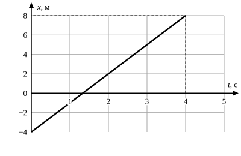

На рисунке показан график зависимости координаты тела, движущегося вдоль оси $Ox,$ от времени.

Чему равна проекция скорости тела на ось ${Ox}$? Ответ дайте в м/с.

## Решение

Координата меняется линейно — движение равномерное. За ${4\ \text{с}}$ она изменилась от ${-4\ \text{м}}$ до ${8\ \text{м}\text{:}}$

$$
v_x = \frac{x - x_0}{t} = \frac{8 - (-4)}{4}\ \text{м/с} = 3\ \text{м/с}.
$$

Ответ: $3\ \text{м/с}$.
