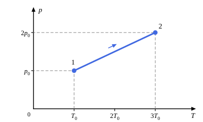

Идеальный газ постоянной массы переводят из состояния 1 в состояние 2. На рисунке показан график зависимости давления $p$ газа от его абсолютной температуры $T.$

Как изменяются в этом процессе объём газа и концентрация его молекул?

Для каждой величины определите соответствующий характер изменения:

1) увеличивается;
2) уменьшается;
3) не изменяется.

Запишите в ответ выбранные цифры для каждой физической величины. Цифры в ответе могут повторяться.

| Объём газа | Концентрация молекул |
|---|---|
| ? | ? |

## Решение

Из ${pV = \nu RT}$ объём ${V = \dfrac{\nu RT}{p}:}$

$$
\frac{V_2}{V_1} = \frac{T_2}{T_1} \cdot \frac{p_1}{p_2} = 3 \cdot \frac{1}{2} = 1{,}5
$$

— объём **увеличивается** (1).

${n = \dfrac{N}{V}:}$ число молекул прежнее, объём больше — концентрация **уменьшается** (2).

Ответ: 12.
