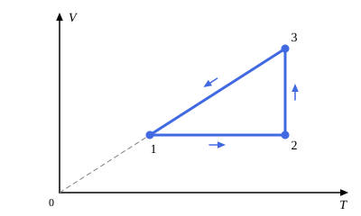

Идеальный газ постоянной массы совершает циклический процесс 1 → 2 → 3 → 1, график которого в координатах «объём $V$ — абсолютная температура $T$» показан на рисунке. Продолжение отрезка 3–1 проходит через начало координат.

Установите соответствие между процессами и их характеристиками. К каждой позиции первого столбца подберите соответствующую позицию из второго столбца.

**Процессы**

А) 1 → 2
Б) 3 → 1

**Характеристики**

1) газ отдаёт теплоту, работа газа равна нулю
2) газ получает теплоту, внутренняя энергия газа не меняется
3) газ получает теплоту, работа газа равна нулю
4) газ отдаёт теплоту, внешние силы совершают над газом положительную работу

Запишите в ответ цифры, расположив их в порядке, соответствующем буквам: А, Б.

## Решение

А) 1 → 2: объём постоянен, температура растёт — изохорное нагревание. ${A = 0,}$ ${Q = \Delta U > 0}$ — характеристика 3.

Б) 3 → 1: точки лежат на прямой ${V \propto T}$ — изобара; температура и объём уменьшаются. ${\Delta U < 0,}$ работа газа ${A < 0}$ (внешние силы совершают положительную работу), ${Q = \Delta U + A < 0}$ — газ отдаёт теплоту. Характеристика 4.

Ответ: 34.
