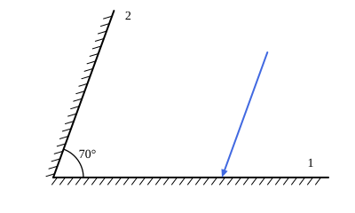

Два плоских зеркала образуют двугранный угол ${70^\circ.}$ Луч света, лежащий в плоскости, перпендикулярной обоим зеркалам, идёт параллельно зеркалу 2 и падает на зеркало 1 (см. рисунок). Отразившись от зеркала 1, луч попадает на зеркало 2. Определите угол падения луча на зеркало 2. Ответ дайте в градусах.

## Решение

Луч параллелен зеркалу 2, поэтому с поверхностью зеркала 1 он составляет угол ${70^\circ}$ (как зеркало 2). Отражённый луч составляет с зеркалом 1 тот же угол ${70^\circ.}$

Отражённый луч и два зеркала образуют треугольник с углами ${70^\circ}$ (между зеркалами) и ${70^\circ}$ (у зеркала 1). Угол между лучом и поверхностью зеркала 2

$$
180^\circ - 70^\circ - 70^\circ = 40^\circ,
$$

а угол падения, отсчитанный от перпендикуляра, ${90^\circ - 40^\circ = 50^\circ.}$

Ответ: $50^\circ$.
