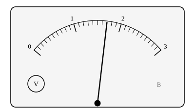

На рисунке показана шкала вольтметра.

Абсолютная погрешность измерения напряжения этим вольтметром ${\Delta U = 0{,}1\ \text{В}.}$ Запишите показание вольтметра с учётом погрешности. Ответ дайте в вольтах.

## Решение

Между отметками $1$ и $2\ \text{В}$ — $10$ промежутков, цена деления ${\dfrac{1\ \text{В}}{10} = 0{,}1\ \text{В}.}$

Стрелка стоит на седьмом штрихе после отметки ${1\ \text{В}\text{:}}$ ${U = 1 + 7 \cdot 0{,}1 = 1{,}7\ \text{В}.}$

Погрешность дана: ${\Delta U = 0{,}1\ \text{В}.}$

Ответ: ${(1{,}7 \pm 0{,}1)\ \text{В}.}$
