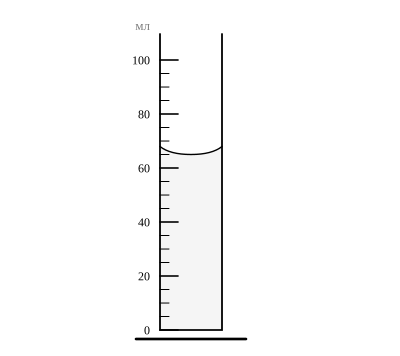

В мензурку налита вода.

Погрешность измерения объёма равна цене деления мензурки. Запишите объём воды с учётом погрешности. Ответ дайте в миллилитрах.

## Решение

Между отметками $60$ и $80\ \text{мл}$ — $4$ промежутка, цена деления ${\dfrac{20\ \text{мл}}{4} = 5\ \text{мл}.}$

Нижний край мениска — на первом штрихе выше отметки ${60\ \text{мл}\text{:}}$ ${V = 60 + 5 = 65\ \text{мл}.}$

Погрешность равна цене деления: ${\Delta V = 5\ \text{мл}.}$

Ответ: ${(65 \pm 5)\ \text{мл}.}$
