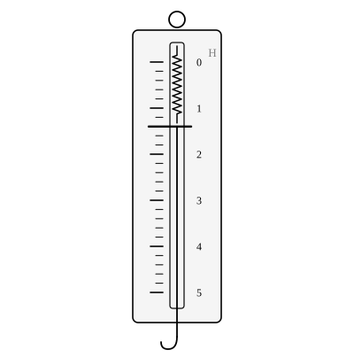

На рисунке показан динамометр с подвешенным к нему грузом.

Погрешность измерения силы равна половине цены деления динамометра. Запишите показание динамометра с учётом погрешности. Ответ дайте в ньютонах.

## Решение

Между отметками $1$ и $2\ \text{Н}$ — $5$ промежутков, цена деления ${\dfrac{1\ \text{Н}}{5} = 0{,}2\ \text{Н}.}$

Указатель на втором штрихе после отметки ${1\ \text{Н}\text{:}}$ ${F = 1 + 2 \cdot 0{,}2 = 1{,}4\ \text{Н}.}$

Погрешность — половина цены деления: ${\Delta F = 0{,}1\ \text{Н}.}$

Ответ: ${(1{,}4 \pm 0{,}1)\ \text{Н}.}$
