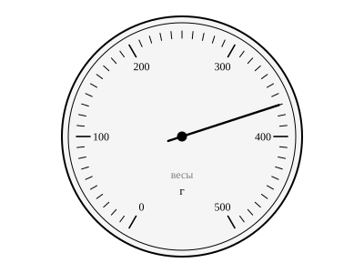

На рисунке показана шкала кухонных весов, на которые положили продукты.

Погрешность измерения массы равна цене деления шкалы. Запишите показание весов с учётом погрешности. Ответ дайте в граммах.

## Решение

Между отметками $300$ и $400\ \text{г}$ — $10$ промежутков, цена деления ${\dfrac{100\ \text{г}}{10} = 10\ \text{г}.}$

Стрелка на седьмом штрихе после отметки ${300\ \text{г}\text{:}}$ ${m = 300 + 7 \cdot 10 = 370\ \text{г}.}$

Погрешность равна цене деления: ${\Delta m = 10\ \text{г}.}$

Ответ: ${(370 \pm 10)\ \text{г}.}$
