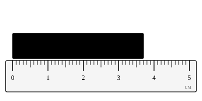

Длину ластика измеряют линейкой. Левый край ластика совмещён с нулевой отметкой.

Погрешность измерения длины равна ${1\ \text{мм}.}$ Запишите длину ластика с учётом погрешности. Ответ дайте в сантиметрах.

## Решение

Между отметками $3$ и $4\ \text{см}$ — $10$ промежутков, цена деления ${0{,}1\ \text{см} = 1\ \text{мм}.}$

Правый край ластика — на седьмом штрихе после отметки ${3\ \text{см}\text{:}}$ ${l = 3 + 7 \cdot 0{,}1 = 3{,}7\ \text{см}.}$

Погрешность ${\Delta l = 1\ \text{мм} = 0{,}1\ \text{см}.}$

Ответ: ${(3{,}7 \pm 0{,}1)\ \text{см}.}$
