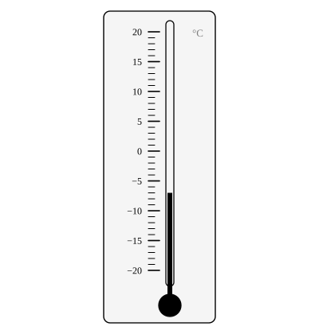

На рисунке показан уличный термометр.

Погрешность измерения температуры равна цене деления шкалы. Запишите показание термометра с учётом погрешности. Ответ дайте в градусах Цельсия.

## Решение

Между отметками $-10$ и ${-5\ ^\circ\text{C}}$ — $5$ промежутков, цена деления ${\dfrac{5\ ^\circ\text{C}}{5} = 1\ ^\circ\text{C}.}$

Столбик доходит до второго штриха ниже отметки ${-5\ ^\circ\text{C}\text{:}}$ ${t = -5 - 2 \cdot 1 = -7\ ^\circ\text{C}.}$

Погрешность равна цене деления: ${\Delta t = 1\ ^\circ\text{C}.}$

Ответ: ${(-7 \pm 1)\ ^\circ\text{C}.}$
