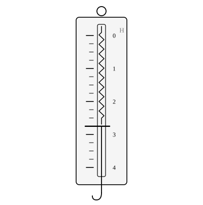

На рисунке показан динамометр с подвешенным к нему грузом.

Погрешность измерения силы равна цене деления динамометра. Запишите показание динамометра с учётом погрешности. Ответ дайте в ньютонах.

## Решение

Между отметками $2$ и $3\ \text{Н}$ — $4$ промежутка, цена деления ${\dfrac{1\ \text{Н}}{4} = 0{,}25\ \text{Н}.}$

Указатель на третьем штрихе после отметки ${2\ \text{Н}\text{:}}$ ${F = 2 + 3 \cdot 0{,}25 = 2{,}75\ \text{Н}.}$

Погрешность равна цене деления: ${\Delta F = 0{,}25\ \text{Н}.}$ Знаков после запятой в показании и в погрешности по два.

Ответ: ${(2{,}75 \pm 0{,}25)\ \text{Н}.}$
