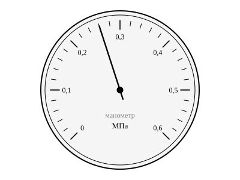

На рисунке показана шкала манометра, проградуированная в мегапаскалях.

Погрешность измерения давления равна половине цены деления шкалы. Запишите показание манометра с учётом погрешности. Ответ дайте в килопаскалях.

## Решение

Между отметками $0{,}2$ и $0{,}3\ \text{МПа}$ — $5$ промежутков, цена деления ${\dfrac{0{,}1\ \text{МПа}}{5} = 0{,}02\ \text{МПа}.}$

Стрелка на третьем штрихе после отметки ${0{,}2\ \text{МПа}\text{:}}$ ${p = 0{,}2 + 3 \cdot 0{,}02 = 0{,}26\ \text{МПа}.}$

Погрешность — половина цены деления: ${\Delta p = 0{,}01\ \text{МПа}.}$

В килопаскалях: ${p = 260\ \text{кПа},}$ ${\Delta p = 10\ \text{кПа}.}$

Ответ: ${(260 \pm 10)\ \text{кПа}.}$
