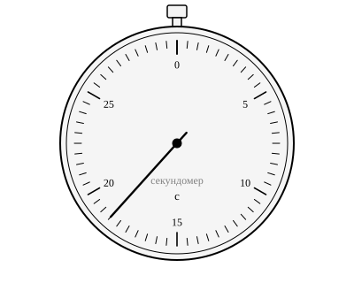

На рисунке показан циферблат секундомера, стрелка которого делает полный оборот за ${30\ \text{с}.}$

Погрешность измерения времени равна цене деления шкалы. Запишите показание секундомера с учётом погрешности. Ответ дайте в секундах.

## Решение

Между отметками $15$ и $20\ \text{с}$ — $10$ промежутков, цена деления ${\dfrac{5\ \text{с}}{10} = 0{,}5\ \text{с}.}$

Стрелка на седьмом штрихе после отметки ${15\ \text{с}\text{:}}$ ${t = 15 + 7 \cdot 0{,}5 = 18{,}5\ \text{с}.}$

Погрешность равна цене деления: ${\Delta t = 0{,}5\ \text{с}.}$

Ответ: ${(18{,}5 \pm 0{,}5)\ \text{с}.}$
