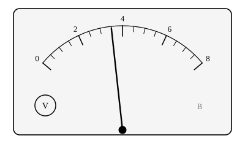

На рисунке показана шкала вольтметра.

Погрешность измерения напряжения равна цене деления вольтметра. Запишите показание вольтметра с учётом погрешности. Ответ дайте в вольтах.

## Решение

Между отметками $2$ и $4\ \text{В}$ — $4$ промежутка, цена деления ${\dfrac{2\ \text{В}}{4} = 0{,}5\ \text{В}.}$

Стрелка на третьем штрихе после отметки ${2\ \text{В}\text{:}}$ ${U = 2 + 3 \cdot 0{,}5 = 3{,}5\ \text{В}.}$

Погрешность равна цене деления: ${\Delta U = 0{,}5\ \text{В}.}$

Ответ: ${(3{,}5 \pm 0{,}5)\ \text{В}.}$
