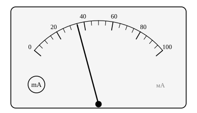

На рисунке показана шкала миллиамперметра.

Погрешность измерения силы тока равна цене деления прибора. Запишите показание прибора с учётом погрешности. Ответ дайте в амперах.

## Решение

Между отметками $20$ и $40\ \text{мА}$ — $4$ промежутка, цена деления ${\dfrac{20\ \text{мА}}{4} = 5\ \text{мА}.}$

Стрелка на третьем штрихе после отметки ${20\ \text{мА}\text{:}}$ ${I = 20 + 3 \cdot 5 = 35\ \text{мА}.}$

Погрешность ${\Delta I = 5\ \text{мА}.}$ В амперах: ${I = 0{,}035\ \text{А},}$ ${\Delta I = 0{,}005\ \text{А}.}$

Ответ: ${(0{,}035 \pm 0{,}005)\ \text{А}.}$
