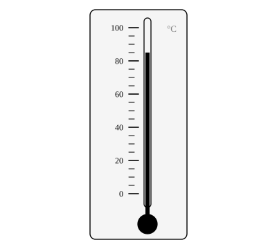

На рисунке показан лабораторный термометр.

Погрешность измерения температуры равна половине цены деления шкалы. Запишите показание термометра с учётом погрешности. Ответ дайте в градусах Цельсия.

## Решение

Между отметками $80$ и ${100\ ^\circ\text{C}}$ — $4$ промежутка, цена деления ${\dfrac{20\ ^\circ\text{C}}{4} = 5\ ^\circ\text{C}.}$

Столбик доходит до первого штриха выше отметки ${80\ ^\circ\text{C}\text{:}}$ ${t = 80 + 5 = 85\ ^\circ\text{C}.}$

Погрешность — половина цены деления: ${\Delta t = 2{,}5\ ^\circ\text{C}.}$ У погрешности один знак после запятой, значит, и показание записываем с одним: ${85{,}0.}$

Ответ: ${(85{,}0 \pm 2{,}5)\ ^\circ\text{C}.}$
