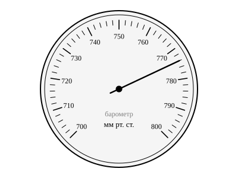

На рисунке показана шкала барометра-анероида, проградуированная в миллиметрах ртутного столба.

Погрешность измерения давления равна половине цены деления шкалы. Запишите показание барометра с учётом погрешности. Ответ дайте в миллиметрах ртутного столба.

## Решение

Между отметками $770$ и $780$ — $5$ промежутков, цена деления ${\dfrac{10\ \text{мм рт. ст.}}{5} = 2\ \text{мм рт. ст.}}$

Стрелка на втором штрихе после отметки ${770\text{:}}$ ${p = 770 + 2 \cdot 2 = 774\ \text{мм рт. ст.}}$

Погрешность — половина цены деления: ${\Delta p = 1\ \text{мм рт. ст.}}$

Ответ: ${(774 \pm 1)\ \text{мм рт. ст.}}$
