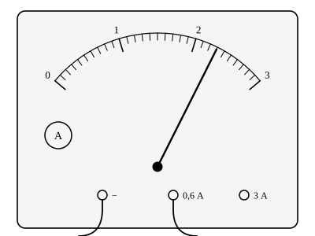

У школьного амперметра два предела измерения: $3\ \text{А}$ и ${0{,}6\ \text{А}.}$ Подписи на его шкале сделаны для предела ${3\ \text{А}.}$ Амперметр включён в цепь клеммами «−» и «${0{,}6\ \text{А}}$», то есть при отклонении стрелки до конца шкалы сила тока равна ${0{,}6\ \text{А}.}$

Погрешность измерения силы тока равна половине цены деления. Запишите показание амперметра с учётом погрешности. Ответ дайте в амперах.

## Решение

На шкале $3 \cdot 10 = 30$ промежутков. На пределе $0{,}6\ \text{А}$ цена деления ${\dfrac{0{,}6\ \text{А}}{30} = 0{,}02\ \text{А}.}$

Стрелка стоит на $23$-м штрихе от нуля: ${I = 23 \cdot 0{,}02 = 0{,}46\ \text{А}.}$

Погрешность — половина цены деления: ${\Delta I = 0{,}01\ \text{А}.}$

Ответ: ${(0{,}46 \pm 0{,}01)\ \text{А}.}$
