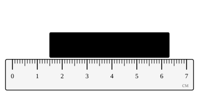

Длину бруска измеряют линейкой, проградуированной в сантиметрах и миллиметрах. Брусок положили так, как показано на рисунке.

Погрешность измерения длины равна цене деления линейки. Запишите длину бруска с учётом погрешности. Ответ дайте в миллиметрах.

## Решение

Цена деления линейки ${1\ \text{мм} = 0{,}1\ \text{см}.}$

Левый край бруска — у отметки ${1{,}5\ \text{см},}$ правый — у отметки ${6{,}3\ \text{см}.}$ Длина ${l = 6{,}3 - 1{,}5 = 4{,}8\ \text{см} = 48\ \text{мм}.}$

Погрешность равна цене деления: ${\Delta l = 1\ \text{мм}.}$

Ответ: ${(48 \pm 1)\ \text{мм}.}$
