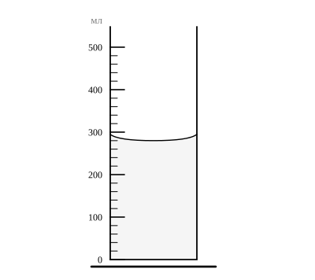

В мерный стакан налита вода.

Погрешность измерения объёма равна половине цены деления шкалы. Запишите объём воды с учётом погрешности. Ответ дайте в литрах.

## Решение

Между отметками $200$ и $300\ \text{мл}$ — $5$ промежутков, цена деления ${\dfrac{100\ \text{мл}}{5} = 20\ \text{мл}.}$

Нижний край мениска — на четвёртом штрихе выше отметки ${200\ \text{мл}\text{:}}$ ${V = 200 + 4 \cdot 20 = 280\ \text{мл}.}$

Погрешность — половина цены деления: ${\Delta V = 10\ \text{мл}.}$

В литрах: ${V = 0{,}28\ \text{л},}$ ${\Delta V = 0{,}01\ \text{л}.}$

Ответ: ${(0{,}28 \pm 0{,}01)\ \text{л}.}$
