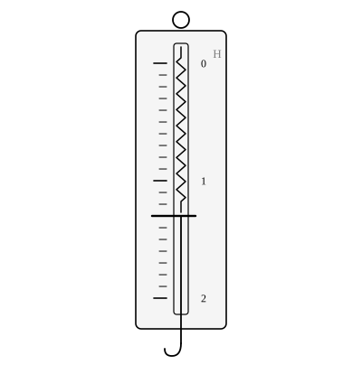

К динамометру подвесили груз, который покоится.

Погрешность измерения силы равна цене деления динамометра. Запишите массу груза с учётом погрешности. Ускорение свободного падения примите равным ${10\ \text{Н/кг}.}$ Ответ дайте в граммах.

## Решение

Между отметками $1$ и $2\ \text{Н}$ — $10$ промежутков, цена деления ${0{,}1\ \text{Н}.}$

Указатель на третьем штрихе после отметки ${1\ \text{Н}\text{:}}$ вес ${P = 1 + 3 \cdot 0{,}1 = 1{,}3\ \text{Н},}$ погрешность ${\Delta P = 0{,}1\ \text{Н}.}$

Груз покоится, поэтому вес равен силе тяжести: ${P = mg.}$

$$
\begin{aligned}
m &= \frac{P}{g} = \frac{1{,}3\ \text{Н}}{10\ \text{Н/кг}} = 0{,}13\ \text{кг} = 130\ \text{г},\\
\Delta m &= \frac{\Delta P}{g} = 0{,}01\ \text{кг} = 10\ \text{г}.
\end{aligned}
$$

Ответ: ${(130 \pm 10)\ \text{г}.}$
