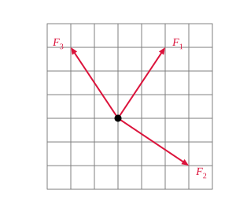

На тело действуют три силы, лежащие в одной плоскости (см. рисунок). Сторона клетки соответствует ${2\ \text{Н}.}$

Определите модуль равнодействующей этих сил. Ответ дайте в ньютонах.

## Решение

Сложим составляющие сил в клетках (ось $x$ вправо, ось $y$ вверх):

$$
\begin{aligned}
R_x &= 2 + 3 - 2 = 3, \\
R_y &= 3 - 2 + 3 = 4.
\end{aligned}
$$

Модуль равнодействующей ${\sqrt{3^2 + 4^2} = 5}$ клеток, то есть ${5 \cdot 2\ \text{Н} = 10\ \text{Н}.}$

Ответ: $10\ \text{Н}$.
