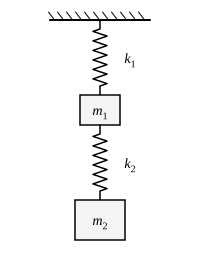

К потолку на лёгкой пружине жёсткостью ${250\ \text{Н/м}}$ подвешен груз массой ${0{,}4\ \text{кг}.}$ К этому грузу на второй лёгкой пружине жёсткостью ${200\ \text{Н/м}}$ подвешен груз массой ${0{,}6\ \text{кг}}$ (см. рисунок). Грузы покоятся. На сколько растянута верхняя пружина? Ответ дайте в сантиметрах.

## Решение

Рассмотрим оба груза и нижнюю пружину как одно тело. Оно покоится, на него действуют сила тяжести ${(m_1 + m_2)\,g}$ и сила упругости верхней пружины ${k_1 \Delta l_1}$:

$$
\Delta l_1 = \frac{(m_1 + m_2)\,g}{k_1} = \frac{1 \cdot 10}{250}\ \text{м} = 0{,}04\ \text{м} = 4\ \text{см}.
$$

Ответ: $4\ \text{см}$.
