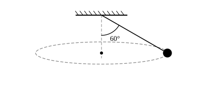

Маленький шарик, подвешенный на лёгкой нерастяжимой нити длиной ${1\ \text{м},}$ равномерно движется по окружности в горизонтальной плоскости. Нить при этом составляет с вертикалью угол ${60^\circ}$ (см. рисунок). Определите модуль скорости шарика. Сопротивлением воздуха пренебречь, ${g = 10\ \text{м/с}^2.}$

## Решение

Шарик — материальная точка, система отсчёта, связанная с Землёй, инерциальна. На шарик действуют сила тяжести ${m\vec g}$ (вниз) и сила натяжения нити ${\vec T}$ (вдоль нити к точке подвеса). Шарик равномерно движется по окружности радиусом

$$
r = l\sin\alpha,
$$

центр которой лежит на вертикали под точкой подвеса. Его ускорение — центростремительное, ${a = \dfrac{v^2}{r},}$ направлено горизонтально к центру.

**Второй закон Ньютона** в проекциях на вертикаль и на горизонтальное направление к центру:

$$
\begin{aligned}
T\cos\alpha - mg &= 0, \\
T\sin\alpha &= \frac{mv^2}{r}.
\end{aligned}
$$

Делим второе уравнение на первое (${T\cos\alpha = mg}$):

$$
\frac{v^2}{r} = g\operatorname{tg}\alpha,
$$

$$
v^2 = g\,l\sin\alpha\operatorname{tg}\alpha.
$$

$$
v^2 = 10 \cdot 1 \cdot \frac{\sqrt 3}{2} \cdot \sqrt 3\ \text{м}^2/\text{с}^2 = 15\ \text{м}^2/\text{с}^2,
$$

$$
v = \sqrt{15}\ \text{м/с} \approx 3{,}9\ \text{м/с}.
$$

Ответ: ${v \approx 3{,}9\ \text{м/с}.}$
