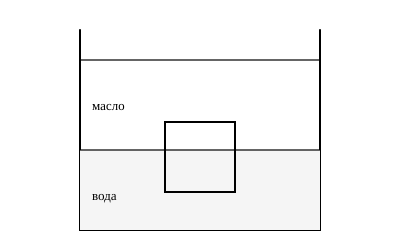
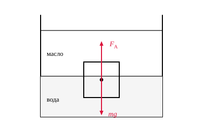

В сосуд налита вода, а поверх неё — толстый слой масла плотностью ${800\ \text{кг/м}^3.}$ Однородный кубик с ребром ${10\ \text{см}}$ и плотностью ${920\ \text{кг/м}^3}$ плавает на границе жидкостей так, что его нижняя часть находится в воде, а верхняя — в масле (см. рисунок). Определите, на какую глубину кубик погружён в воду. Плотность воды ${1000\ \text{кг/м}^3.}$ Сделайте схематичный рисунок с указанием сил, действующих на кубик.

## Решение

Систему отсчёта, связанную с сосудом, считаем инерциальной. Кубик покоится, поэтому сумма действующих на него сил равна нулю. На кубик действуют сила тяжести ${m\vec g}$ (вниз) и выталкивающая сила ${\vec F_{\text{А}}}$ (вверх) — равнодействующая сил давления воды и масла.

**Закон Архимеда для двух жидкостей.** Пусть ${a}$ — ребро кубика, ${h}$ — глубина его погружения в воду. В воде находится объём ${a^2 h,}$ в масле — объём ${a^2 (a - h).}$ Выталкивающая сила равна весу вытесненных воды и масла:

$$
F_{\text{А}} = \rho_{\text{в}} g a^2 h + \rho_{\text{м}} g a^2 (a - h).
$$

**Условие равновесия** ${F_{\text{А}} = mg = \rho g a^3\text{:}}$

$$
\rho_{\text{в}} h + \rho_{\text{м}} (a - h) = \rho a,
$$

$$
h = a\,\frac{\rho - \rho_{\text{м}}}{\rho_{\text{в}} - \rho_{\text{м}}} = 10 \cdot \frac{920 - 800}{1000 - 800}\ \text{см} = 6\ \text{см}.
$$

Ответ: ${h = 6\ \text{см}.}$
