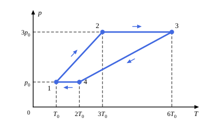

Одноатомный идеальный газ постоянной массы совершает циклический процесс 1–2–3–4–1, график которого в координатах ${p\text{–}T}$ показан на рисунке. Участки 1–2 и 3–4 лежат на прямых, проходящих через начало координат. Определите КПД цикла.

## Решение

1. На участках 1–2 и 3–4 давление пропорционально температуре — это изохоры. На участках 2–3 и 4–1 давление постоянно — это изобары.

2. По уравнению Клапейрона — Менделеева ${V = \dfrac{\nu RT}{p}.}$ Обозначим ${V_1 = \dfrac{\nu RT_0}{p_0}.}$ Тогда ${V_2 = \dfrac{\nu R \cdot 3T_0}{3p_0} = V_1,}$ ${V_3 = \dfrac{\nu R \cdot 6T_0}{3p_0} = 2V_1,}$ ${V_4 = \dfrac{\nu R \cdot 2T_0}{p_0} = 2V_1.}$ В координатах ${p\text{–}V}$ цикл — прямоугольник, обходимый по часовой стрелке.

3. Работа газа за цикл равна площади прямоугольника:

$$
A = (3p_0 - p_0)(2V_1 - V_1) = 2p_0V_1.
$$

4. Газ получает теплоту на участках 1–2 (изохорное нагревание) и 2–3 (изобарное расширение с нагреванием). По первому закону термодинамики

$$
Q_{12} = \frac{3}{2}(p_2 - p_1)V_1 = 3p_0V_1.
$$

$$
Q_{23} = \frac{3}{2}p_2\Delta V + p_2\Delta V = \frac{5}{2} \cdot 3p_0V_1 = 7{,}5p_0V_1.
$$

На участках 3–4 и 4–1 газ охлаждается и отдаёт теплоту.

5. КПД цикла

$$
\eta = \frac{A}{Q_{12} + Q_{23}} = \frac{2}{3 + 7{,}5} \approx 0{,}19 = 19\,\%.
$$

Ответ: ${\eta \approx 19\,\%.}$
