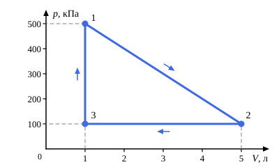

Одноатомный идеальный газ постоянной массы совершает циклический процесс 1 → 2 → 3 → 1, график которого показан на рисунке. На участке 1–2 давление газа линейно убывает с ростом объёма. Определите КПД цикла.

## Решение

Газ одноатомный идеальный, масса постоянна, поэтому ${U = \dfrac{3}{2}\nu RT = \dfrac{3}{2}pV.}$ Давление выражаем в килопаскалях, объём в литрах: их произведение — в джоулях.

**Работа за цикл** равна площади треугольника:

$$
A = \frac{1}{2}(5 - 1) \cdot (500 - 100)\ \text{Дж} = 800\ \text{Дж}.
$$

**Участки 3–1 и 2–3.** На изохоре 3–1 давление растёт, температура растёт, работы нет (первый закон термодинамики ${Q = \Delta U + A}$):

$$
\begin{aligned}
Q_{31} &= \frac{3}{2}V_1(p_1 - p_3) = \\
&= 1{,}5 \cdot 1 \cdot 400\ \text{Дж} = 600\ \text{Дж}.
\end{aligned}
$$

На изобаре 2–3 газ сжимается и охлаждается — он отдаёт теплоту.

**Участок 1–2.** Произведение ${pV}$ в точках 1 и 2 одинаково (${500\ \text{Дж}}$), значит, ${T_1 = T_2,}$ но внутри отрезка температура выше. Знак теплоты здесь может смениться. На отрезке ${p = 600 - 100V.}$ При малом расширении ${\Delta V}$ по первому закону термодинамики

$$
\Delta Q = \frac{3}{2}\Delta(pV) + p\Delta V,
$$

$$
\Delta(pV) = (600 - 200V)\Delta V,
$$

$$
\Delta Q = (1500 - 400V)\Delta V.
$$

Газ получает теплоту, пока ${V < 3{,}75\ \text{л}}$ (там ${p^* = 225\ \text{кПа}}$), а дальше отдаёт. Теплота, полученная от точки 1 до этой точки:

$$
\begin{aligned}
Q_{1*} &= \frac{3}{2}(p^*V^* - p_1V_1) + \frac{p_1 + p^*}{2}(V^* - V_1) = \\
&= 1{,}5 \cdot (843{,}75 - 500) + 362{,}5 \cdot 2{,}75 = \\
&= 515{,}625 + 996{,}875 = 1512{,}5\ \text{Дж}.
\end{aligned}
$$

**Полученная за цикл теплота:**

$$
Q_{\text{н}} = Q_{31} + Q_{1*} = 600 + 1512{,}5 = 2112{,}5\ \text{Дж}.
$$

**КПД:**

$$
\eta = \frac{A}{Q_{\text{н}}} = \frac{800}{2112{,}5} \approx 0{,}38 = 38\,\%.
$$

Ответ: ${\eta \approx 38\,\%.}$
