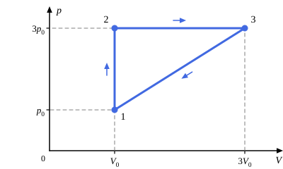

Одноатомный идеальный газ постоянной массы совершает циклический процесс 1 → 2 → 3 → 1, график которого показан на рисунке. На участке 3–1 давление газа прямо пропорционально его объёму. Определите КПД цикла.

## Решение

Газ одноатомный идеальный, ${U = \dfrac{3}{2}\nu RT = \dfrac{3}{2}pV.}$ Состояния: ${1\ (V_0, p_0),}$ ${2\ (V_0, 3p_0),}$ ${3\ (3V_0, 3p_0).}$

**Работа за цикл** — площадь треугольника 1–2–3:

$$
A = \frac{1}{2}(3V_0 - V_0)(3p_0 - p_0) = 2p_0V_0.
$$

**Количество теплоты на участках** по первому закону термодинамики ${Q = \Delta U + A_{\text{газа}}:}$

- 1–2, изохорное нагревание: ${Q_{12} = \frac{3}{2}(3p_0V_0 - p_0V_0) = 3p_0V_0 > 0;}$
- 2–3, изобарное расширение: ${Q_{23} = \frac{5}{2} \cdot 3p_0 \cdot 2V_0 = 15p_0V_0 > 0;}$
- 3–1, сжатие: ${A_{\text{газа}} < 0}$ и ${\Delta U = \frac{3}{2}(p_0V_0 - 9p_0V_0) < 0,}$ поэтому ${Q_{31} < 0}$ — газ отдаёт теплоту.

Теплота от нагревателя ${Q_{\text{н}} = Q_{12} + Q_{23} = 18p_0V_0.}$

**КПД:**

$$
\eta = \frac{A}{Q_{\text{н}}} = \frac{2}{18} = \frac{1}{9} \approx 0{,}11 = 11\,\%.
$$

Ответ: ${\eta \approx 11\,\%.}$
