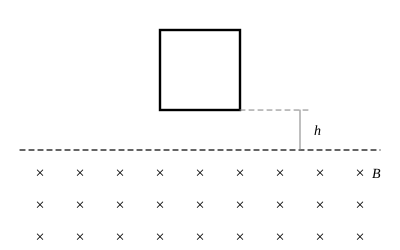

Квадратная рамка из медной проволоки падает без начальной скорости, оставаясь в вертикальной плоскости; её нижняя сторона горизонтальна. Под рамкой находится область однородного магнитного поля с индукцией ${0{,}1\ \text{Тл},}$ линии которого горизонтальны и перпендикулярны плоскости рамки, а верхняя граница области горизонтальна (см. рисунок). Рамка входит в область поля с постоянной скоростью. С какой высоты над границей поля (считая от нижней стороны рамки) она начала падать? Удельное сопротивление меди ${1{,}7 \cdot 10^{-8}\ \text{Ом} \cdot \text{м},}$ плотность меди ${8900\ \text{кг/м}^3.}$ Сопротивлением воздуха и самоиндукцией пренебречь, ${g = 10\ \text{м/с}^2.}$

## Решение

Пусть ${a}$ — сторона рамки, ${S}$ — сечение проволоки, ${\rho}$ — удельное сопротивление меди, ${\rho_{\text{м}}}$ — её плотность. Длина проволоки ${4a,}$ поэтому масса и сопротивление рамки

$$
m = \rho_{\text{м}} \cdot 4aS,
$$

$$
R = \frac{\rho \cdot 4a}{S}.
$$

**Вход в поле.** Пока рамка входит в поле, в нём движется только нижняя сторона. В ней возникает ЭДС индукции ${Bav,}$ по рамке идёт ток ${I = Bav/R.}$ На нижнюю сторону действует сила Ампера ${BIa,}$ по правилу Ленца направленная вверх, против движения. Силы Ампера на участки боковых сторон, вошедшие в поле, равны и противоположны, а верхняя сторона вне поля. Скорость постоянна, значит, сила Ампера уравновешивает силу тяжести:

$$
mg = BIa = \frac{B^2a^2v}{R},
$$

$$
v = \frac{mgR}{B^2a^2} = \frac{16\rho\rho_{\text{м}}g}{B^2}.
$$

Сторона рамки и сечение проволоки сократились:

$$
v = \frac{16 \cdot 1{,}7 \cdot 10^{-8} \cdot 8900 \cdot 10}{0{,}01}\ \text{м/с} \approx 2{,}42\ \text{м/с}.
$$

**Падение до границы.** До входа в поле рамка падает свободно (тока в ней нет, поток через неё не меняется):

$$
h = \frac{v^2}{2g} = \frac{2{,}42^2}{20}\ \text{м} \approx 0{,}29\ \text{м}.
$$

Ответ: ${h \approx 29\ \text{см}.}$
