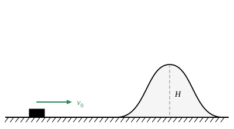

На гладком горизонтальном полу стоит незакреплённая гладкая горка массой ${2\ \text{кг}}$ и высотой ${50\ \text{см}.}$ Её склоны плавно переходят в пол. На горку со скоростью ${3\ \text{м/с}}$ въезжает маленькая шайба массой ${0{,}5\ \text{кг}}$ (см. рисунок). Определите наибольшую высоту, на которую поднимется шайба, и скорость горки после того, как шайба съедет с неё. ${g = 10\ \text{м/с}^2.}$

Какие законы вы используете для решения задачи? Обоснуйте их применимость.

## Решение

**Обоснование.**

1. Систему отсчёта, связанную с полом, считаем инерциальной.
2. Шайба маленькая — материальная точка. Горка движется поступательно, поэтому её тоже можно описывать как материальную точку.
3. Пол гладкий: внешние силы, действующие на систему «шайба + горка», — силы тяжести и сила реакции пола — вертикальны. Поэтому сохраняется горизонтальная проекция импульса системы. Вертикальная проекция не сохраняется: пока шайба поднимается, сила реакции пола не равна суммарной силе тяжести.
4. Трения нет. Сила реакции пола перпендикулярна перемещению горки и работы не совершает. Силы взаимодействия шайбы и горки перпендикулярны поверхности горки, и их суммарная работа равна нулю. Значит, механическая энергия системы сохраняется.

**Решение.**

Пусть ${m = 0{,}5\ \text{кг},}$ ${M = 2\ \text{кг},}$ ${v_0 = 3\ \text{м/с},}$ ${H = 0{,}5\ \text{м}.}$

**Подъём.** В наивысшей точке шайба покоится относительно горки, и обе движутся с общей скоростью ${v\text{:}}$

$$
\begin{aligned}
m v_0 &= (m + M)\,v, \\
\frac{m v_0^2}{2} &= \frac{(m + M)\,v^2}{2} + m g h.
\end{aligned}
$$

Отсюда ${v = \dfrac{m v_0}{m + M} = 0{,}6\ \text{м/с}}$ и

$$
h = \frac{M v_0^2}{2g\,(m + M)} = \frac{2 \cdot 9}{2 \cdot 10 \cdot 2{,}5}\ \text{м} = 0{,}36\ \text{м}.
$$

**Проверка.** ${h = 0{,}36\ \text{м} < H = 0{,}5\ \text{м}\text{:}}$ шайба не доезжает до вершины и съезжает обратно по тому же склону.

**Возвращение.** Когда шайба снова на полу, её потенциальная энергия та же, что вначале. Пусть ${v_1}$ — скорость шайбы, ${u}$ — скорость горки (проекции на направление ${v_0}$):

$$
\begin{aligned}
m v_0 &= m v_1 + M u, \\
m v_0^2 &= m v_1^2 + M u^2.
\end{aligned}
$$

Как при упругом ударе, из этих уравнений ${v_0 + v_1 = u,}$ и

$$
u = \frac{2m}{m + M}\,v_0 = \frac{2 \cdot 0{,}5}{2{,}5} \cdot 3\ \text{м/с} = 1{,}2\ \text{м/с},
$$

$$
v_1 = u - v_0 = -1{,}8\ \text{м/с}.
$$

Шайба едет назад, горка — вперёд.

Ответ: ${h = 0{,}36\ \text{м},}$ ${u = 1{,}2\ \text{м/с}.}$
