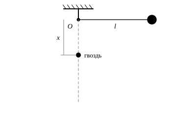

Маленький шарик подвешен на лёгкой нерастяжимой нити длиной ${90\ \text{см}}$ к точке ${O.}$ Нить отводят в горизонтальное положение и отпускают шарик без начальной скорости. Ниже точки ${O}$ на одной вертикали с ней вбит тонкий гвоздь (см. рисунок). Когда нить доходит до вертикального положения, она зацепляется за гвоздь, и дальше шарик движется по окружности с центром в гвозде. На каком наименьшем расстоянии ${x}$ от точки ${O}$ должен находиться гвоздь, чтобы шарик сделал вокруг гвоздя полный оборот при натянутой нити? Сопротивлением воздуха пренебречь.

Какие законы вы используете для решения задачи? Обоснуйте их применимость.

## Решение

**Обоснование.**

1. Систему отсчёта, связанную с Землёй, считаем инерциальной.
2. Шарик маленький — считаем его материальной точкой.
3. На шарик действуют сила тяжести и сила натяжения нити. Нить нерастяжима, шарик всё время движется по дуге окружности (сначала с центром ${O,}$ затем с центром в гвозде), и сила натяжения перпендикулярна его скорости — работы она не совершает, в том числе в момент зацепления за гвоздь. Сила тяжести потенциальна, сопротивления нет. Поэтому механическая энергия шарика сохраняется.
4. Движение по окружности: по второму закону Ньютона равнодействующая сил в проекции на направление к центру равна ${mv^2/r.}$

**Решение.**

Пусть ${l = 0{,}9\ \text{м},}$ ${r = l - x}$ — радиус окружности вокруг гвоздя. Нижняя точка этой окружности — та же, что у большой; шарик стартовал на ${l}$ выше неё, а верхняя точка малой окружности на ${2r}$ выше неё.

**Энергия.** Закон сохранения энергии от старта до верхней точки малой окружности:

$$
mg(l - 2r) = \frac{mv^2}{2},
$$

$$
v^2 = 2g(l - 2r).
$$

**Верхняя точка.** Второй закон Ньютона, сила натяжения ${T}$ и сила тяжести направлены вниз, к гвоздю:

$$
\frac{mv^2}{r} = mg + T.
$$

Нить натянута, если ${T \geqslant 0,}$ то есть ${v^2 \geqslant gr:}$

$$
2g(l - 2r) \geqslant gr,
$$

$$
r \leqslant \frac{2l}{5} = 36\ \text{см}.
$$

**Положение гвоздя.** ${x = l - r,}$ поэтому

$$
x \geqslant \frac{3l}{5} = 54\ \text{см}.
$$

Ответ: ${x_{\min} = 54\ \text{см}.}$
