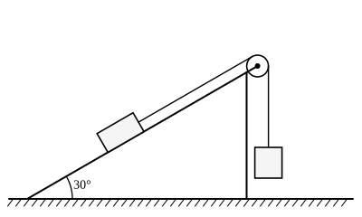

Брусок массой ${2{,}5\ \text{кг}}$ лежит на шероховатой наклонной плоскости, составляющей с горизонтом угол ${30^\circ.}$ Он привязан лёгкой нерастяжимой нитью, перекинутой через лёгкий блок на вершине плоскости, к грузу массой ${1{,}6\ \text{кг},}$ который висит вертикально (см. рисунок). Участок нити от бруска до блока параллелен плоскости. Коэффициент трения бруска о плоскость ${0{,}5.}$ Систему отпускают без начальной скорости. Определите модуль ускорения бруска и модуль силы трения, действующей на брусок. Трением в оси блока пренебречь, ${g = 10\ \text{м/с}^2.}$

Какие законы вы используете для решения задачи? Обоснуйте их применимость.

## Решение

**Обоснование.**

1. Систему отсчёта, связанную с наклонной плоскостью (Землёй), считаем инерциальной.
2. Брусок и груз движутся (или покоятся) поступательно — считаем их материальными точками; для них справедливы законы Ньютона.
3. Нить лёгкая и нерастяжимая, блок лёгкий, трения в его оси нет. Поэтому сила натяжения ${T}$ одинакова по всей нити, а ускорения бруска и груза равны по модулю.
4. Плоскость шероховатая. Пока брусок покоится, на него действует сила трения покоя, модуль которой может принимать любое значение от нуля до ${\mu N.}$ Сила трения скольжения ${\mu N}$ действует, только если брусок скользит.

**Решение.**

Пусть ${M = 2{,}5\ \text{кг},}$ ${m = 1{,}6\ \text{кг},}$ ${\alpha = 30^\circ.}$ Сила реакции плоскости ${N = Mg\cos\alpha.}$

**Сдвинется ли система.** Сравним силы вдоль плоскости при неподвижных телах (тогда ${T = mg}$):

$$
\begin{aligned}
mg &= 1{,}6 \cdot 10 = 16\ \text{Н}, \\
Mg\sin\alpha &= 2{,}5 \cdot 10 \cdot 0{,}5 = 12{,}5\ \text{Н}, \\
\mu Mg\cos\alpha &= 0{,}5 \cdot 2{,}5 \cdot 10 \cdot \frac{\sqrt 3}{2} \approx 10{,}8\ \text{Н}.
\end{aligned}
$$

Нить тянет брусок вверх сильнее, чем его скатывает сила тяжести, на ${16 - 12{,}5 = 3{,}5\ \text{Н}.}$ Это меньше наибольшей силы трения покоя ${10{,}8\ \text{Н},}$ поэтому трение покоя удерживает брусок: система остаётся в покое, ${a = 0.}$ (Если бы брусок пошёл вверх с трением скольжения, ускорение вышло бы отрицательным: ${(16 - 12{,}5 - 10{,}8)/4{,}1 < 0}$ — противоречие.)

**Сила трения.** Условия равновесия груза и бруска (ось вдоль плоскости вверх):

$$
\begin{aligned}
T - mg &= 0, \\
T - Mg\sin\alpha - F_{\text{тр}} &= 0.
\end{aligned}
$$

$$
F_{\text{тр}} = mg - Mg\sin\alpha = 16 - 12{,}5 = 3{,}5\ \text{Н}.
$$

Сила трения покоя направлена вниз вдоль плоскости.

Ответ: ${a = 0,}$ ${F_{\text{тр}} = 3{,}5\ \text{Н}.}$
