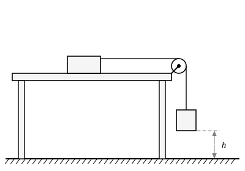

Брусок массой ${0{,}6\ \text{кг}}$ лежит на горизонтальном столе. Он привязан лёгкой нерастяжимой нитью, перекинутой через лёгкий блок на краю стола, к грузу массой ${0{,}4\ \text{кг},}$ который висит на высоте ${50\ \text{см}}$ над полом (см. рисунок). Коэффициент трения бруска о стол ${0{,}2.}$ Систему отпускают без начальной скорости. Груз ударяется о пол и остаётся на нём. Какой путь пройдёт брусок по столу до остановки? Брусок не доходит до блока, трением в оси блока пренебречь, ${g = 10\ \text{м/с}^2.}$

Какие законы вы используете для решения задачи? Обоснуйте их применимость.

## Решение

**Обоснование.**

1. Систему отсчёта, связанную со столом (Землёй), считаем инерциальной.
2. Брусок и груз движутся поступательно — считаем их материальными точками; для них справедливы законы Ньютона.
3. Нить лёгкая и нерастяжимая, блок лёгкий, трения в его оси нет. Поэтому, пока нить натянута, сила натяжения ${T}$ одинакова по всей нити, а ускорения бруска и груза равны по модулю.
4. Брусок скользит по столу, на него действует сила трения скольжения ${\mu N,}$ где ${N = Mg}$ (по вертикали брусок не движется).
5. После удара груз остаётся на полу, а брусок продолжает двигаться и тормозится. Нить не может толкать брусок — она провисает, её натяжение равно нулю.

**Решение.**

Пусть ${M = 0{,}6\ \text{кг},}$ ${m = 0{,}4\ \text{кг},}$ ${h = 0{,}5\ \text{м}.}$ Система трогается: ${mg = 4\ \text{Н}}$ больше наибольшей силы трения ${\mu Mg = 1{,}2\ \text{Н}.}$

**Первый этап.** Второй закон Ньютона для бруска и груза:

$$
Ma = T - \mu Mg,
$$

$$
ma = mg - T.
$$

Складываем:

$$
a = \frac{mg - \mu Mg}{M + m} = \frac{4 - 1{,}2}{1}\ \text{м/с}^2 = 2{,}8\ \text{м/с}^2.
$$

Груз опустился на ${h,}$ брусок прошёл столько же, и его скорость

$$
v^2 = 2ah = 2 \cdot 2{,}8 \cdot 0{,}5\ \text{м}^2/\text{с}^2 = 2{,}8\ \text{м}^2/\text{с}^2.
$$

**Второй этап.** Нить провисла, брусок тормозится силой трения, его ускорение ${\mu g = 2\ \text{м/с}^2:}$

$$
s_2 = \frac{v^2}{2\mu g} = \frac{2{,}8}{2 \cdot 0{,}2 \cdot 10}\ \text{м} = 0{,}7\ \text{м}.
$$

**Весь путь:**

$$
s = h + s_2 = 0{,}5 + 0{,}7 = 1{,}2\ \text{м}.
$$

Ответ: ${s = 1{,}2\ \text{м}.}$
