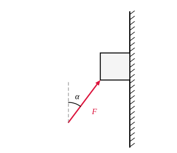

Брусок массой ${1\ \text{кг}}$ прижимают к вертикальной стене силой ${\vec F,}$ направленной вверх под углом ${\alpha}$ к вертикали ${(\sin\alpha = 0{,}6),}$ как показано на рисунке. Коэффициент трения бруска о стену ${0{,}5.}$ При каких значениях модуля силы ${F}$ брусок остаётся в покое? ${g = 10\ \text{м/с}^2.}$

Какие законы вы используете для решения задачи? Обоснуйте их применимость.

## Решение

**Обоснование.**

1. Систему отсчёта, связанную со стеной, считаем инерциальной.
2. Брусок покоится и может только двигаться поступательно вдоль стены — считаем его материальной точкой. По второму закону Ньютона при покое сумма действующих на него сил равна нулю.
3. Пока брусок покоится, на него действует сила трения покоя. Она направлена против того смещения, которое произошло бы без трения, а её модуль может быть любым от нуля до ${\mu N.}$

**Решение.**

На брусок действуют сила тяжести ${mg,}$ сила ${\vec F,}$ сила реакции стены ${N}$ и сила трения покоя ${F_{\text{тр}}.}$ Здесь ${\cos\alpha = 0{,}8.}$

**Горизонтальная ось** (к стене):

$$
N = F\sin\alpha = 0{,}6F.
$$

**Наименьшая сила.** Брусок вот-вот соскользнёт вниз: трение покоя направлено вверх и равно ${\mu N.}$ Вертикальная ось:

$$
F\cos\alpha + \mu F\sin\alpha = mg,
$$

$$
F_{\min} = \frac{mg}{\cos\alpha + \mu\sin\alpha} = \frac{10}{0{,}8 + 0{,}3}\ \text{Н} \approx 9{,}1\ \text{Н}.
$$

**Наибольшая сила.** Брусок вот-вот поедет вверх: трение направлено вниз:

$$
F\cos\alpha - \mu F\sin\alpha = mg,
$$

$$
F_{\max} = \frac{mg}{\cos\alpha - \mu\sin\alpha} = \frac{10}{0{,}8 - 0{,}3}\ \text{Н} = 20\ \text{Н}.
$$

Между этими значениями нужная сила трения покоя меньше ${\mu N,}$ и брусок покоится.

Ответ: ${9{,}1\ \text{Н} \leqslant F \leqslant 20\ \text{Н}.}$
