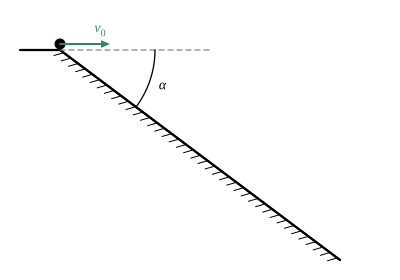

С вершины склона, составляющего с горизонтом угол ${\alpha}$ (${\operatorname{tg}\alpha = 0{,}75}$), горизонтально бросили маленький мяч со скоростью ${8\ \text{м/с}}$ (см. рисунок). На каком расстоянии от точки броска, считая вдоль склона, мяч упадёт на склон? Сопротивлением воздуха пренебречь, ${g = 10\ \text{м/с}^2.}$

Какие законы вы используете для решения задачи? Обоснуйте их применимость.

## Решение

**Обоснование.**

1. Систему отсчёта, связанную с Землёй, считаем инерциальной.
2. Размеры мяча малы по сравнению с расстоянием, которое он пролетает, поэтому мяч считаем материальной точкой.
3. Сопротивления воздуха нет, поэтому в полёте на мяч действует только сила тяжести. По второму закону Ньютона его ускорение постоянно и равно ${\vec g.}$ Значит, по горизонтали мяч движется равномерно, а по вертикали — равноускоренно с ускорением ${g}$ без начальной вертикальной скорости.

**Решение.**

Начало координат — в точке броска, ось ${Ox}$ горизонтально в сторону броска, ось ${Oy}$ вертикально вниз. Законы движения:

$$
\begin{aligned}
x &= v_0 t, \\
y &= \frac{g t^2}{2}.
\end{aligned}
$$

Точка склона, удалённая на ${x}$ по горизонтали, лежит на ${x\operatorname{tg}\alpha}$ ниже вершины. Мяч падает на склон, когда ${y = x\operatorname{tg}\alpha\text{:}}$

$$
\frac{g t^2}{2} = v_0 t\operatorname{tg}\alpha,
$$

$$
t = \frac{2v_0\operatorname{tg}\alpha}{g} = \frac{2 \cdot 8 \cdot 0{,}75}{10}\ \text{с} = 1{,}2\ \text{с}.
$$

Горизонтальное смещение ${x = v_0 t = 8 \cdot 1{,}2 = 9{,}6\ \text{м}.}$ Из ${\operatorname{tg}\alpha = 0{,}75}$ получаем ${\cos\alpha = \dfrac{1}{\sqrt{1 + \operatorname{tg}^2\alpha}} = 0{,}8,}$ и расстояние вдоль склона

$$
L = \frac{x}{\cos\alpha} = \frac{9{,}6}{0{,}8}\ \text{м} = 12\ \text{м}.
$$

Ответ: ${L = 12\ \text{м}.}$
