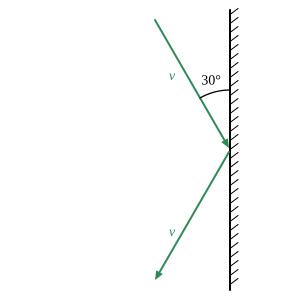

Шарик массой ${0{,}2\ \text{кг}}$ летит со скоростью ${5\ \text{м/с}}$ под углом ${30^\circ}$ к плоскости гладкой вертикальной стены и упруго отскакивает от неё с той же по модулю скоростью (см. рисунок). Определите модуль изменения импульса шарика при ударе. Ответ дайте в $\text{кг} \cdot \text{м/с}.$

## Решение

Составляющая скорости вдоль стены при упругом ударе о гладкую стену не меняется, а перпендикулярная стене составляющая ${v_\perp = v\sin 30^\circ = 2{,}5\ \text{м/с}}$ меняет направление на противоположное. Поэтому вектор изменения импульса перпендикулярен стене:

$$
\begin{aligned}
|\Delta p| &= 2mv\sin 30^\circ = 2 \cdot 0{,}2 \cdot 5 \cdot 0{,}5\ \text{кг} \cdot \text{м/с} = \\
&= 1\ \text{кг} \cdot \text{м/с}.
\end{aligned}
$$

Ответ: $1\ \text{кг} \cdot \text{м/с}$.
