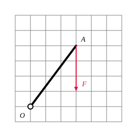

Лёгкий стержень $OA$ может вращаться вокруг оси, проходящей через точку $O$ перпендикулярно плоскости рисунка. К концу $A$ стержня приложена вертикальная сила $\vec F,$ модуль которой ${20\ \text{Н}.}$ Сторона клетки соответствует ${10\ \text{см}.}$

Определите момент силы $\vec F$ относительно оси, проходящей через точку $O.$ Ответ дайте в $\text{Н} \cdot \text{м}.$

## Решение

Плечо силы — длина перпендикуляра, опущенного из точки $O$ на линию действия силы. Сила вертикальна, поэтому плечо равно горизонтальному расстоянию от $O$ до точки $A$: $3$ клетки, то есть ${d = 0{,}3\ \text{м}.}$

$$
M = F d = 20\ \text{Н} \cdot 0{,}3\ \text{м} = 6\ \text{Н} \cdot \text{м}.
$$

Ответ: $6\ \text{Н} \cdot \text{м}$.
