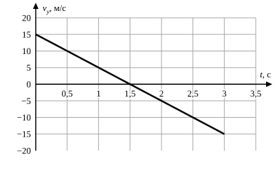

Мяч массой ${0{,}2\ \text{кг}}$ бросили вертикально вверх с поверхности земли. На рисунке приведён график зависимости проекции скорости мяча на вертикальную ось $Oy,$ направленную вверх, от времени. Сопротивлением воздуха пренебречь.

Из приведённого ниже списка выберите все верные утверждения.

1. Наибольшая высота подъёма мяча равна ${11{,}25\ \text{м}.}$
2. В момент ${t = 1{,}5\ \text{с}}$ кинетическая энергия мяча равна нулю.
3. В момент ${t = 1\ \text{с}}$ импульс мяча направлен вертикально вниз.
4. Кинетическая энергия мяча в момент броска равна ${45\ \text{Дж}.}$
5. В момент ${t = 1{,}5\ \text{с}}$ ускорение мяча равно нулю.

## Решение

По графику ${v_0 = 15\ \text{м/с},}$ скорость обращается в ноль при ${t = 1{,}5\ \text{с}}$ — это верхняя точка.

1 — верно: ${h = \dfrac{v_0^2}{2g} = \dfrac{225}{20}\ \text{м} = 11{,}25\ \text{м}.}$

2 — верно: в этот момент ${v_y = 0.}$

3 — неверно: при ${t = 1\ \text{с}}$ ${v_y = 15 - 10 \cdot 1 = 5\ \text{м/с} > 0}$ — мяч ещё летит вверх, импульс направлен вверх.

4 — неверно: ${E_{\text{к}} = \dfrac{0{,}2 \cdot 15^2}{2}\ \text{Дж} = 22{,}5\ \text{Дж}.}$

5 — неверно: наклон графика всё время одинаков, ускорение равно $g$ и в верхней точке.

Ответ: 12.
