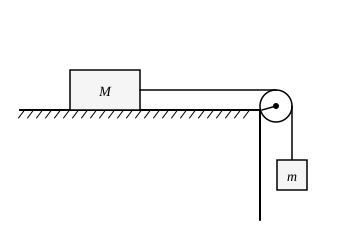

Брусок массой ${2\ \text{кг}}$ лежит на гладком горизонтальном столе. Он связан лёгкой нерастяжимой нитью, перекинутой через лёгкий неподвижный блок на краю стола, с грузом массой ${0{,}5\ \text{кг}}$ (см. рисунок). Систему отпускают, и грузы начинают двигаться. Трением в блоке пренебречь.

Из приведённого ниже списка выберите все верные утверждения.

1. Модуль ускорения грузов равен ${2\ \text{м/с}^2.}$
2. Сила натяжения нити равна ${5\ \text{Н}.}$
3. Висящий груз движется с ускорением $g.$
4. Сила натяжения нити меньше силы тяжести, действующей на висящий груз.
5. Если брусок на столе заменить более тяжёлым, модуль ускорения грузов увеличится.

## Решение

Второй закон Ньютона для бруска и для висящего груза:

$$
\begin{aligned}
Ma &= T, \\
ma &= mg - T.
\end{aligned}
$$

Складывая, ${a = \dfrac{mg}{M + m} = \dfrac{5}{2{,}5}\ \text{м/с}^2 = 2\ \text{м/с}^2,}$ тогда ${T = Ma = 4\ \text{Н}.}$

1 — верно.

2 — неверно: ${T = 4\ \text{Н}.}$

3 — неверно: ${2\ \text{м/с}^2 < g.}$

4 — верно: ${4\ \text{Н} < mg = 5\ \text{Н}}$ — иначе висящий груз не ускорялся бы вниз.

5 — неверно: при большей массе $M$ знаменатель ${M + m}$ растёт, ускорение уменьшается.

Ответ: 14.
