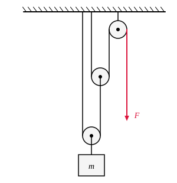

Груз массой ${40\ \text{кг}}$ удерживают с помощью системы блоков, показанной на рисунке: груз подвешен к нижнему подвижному блоку, верёвка этого блока одним концом прикреплена к потолку, а другим — к оси верхнего подвижного блока; верёвка верхнего подвижного блока одним концом прикреплена к потолку, а другой её конец перекинут через неподвижный блок. Массой блоков и верёвок, а также трением пренебречь.

Из приведённого ниже списка выберите все верные утверждения.

1. Чтобы удерживать груз, к свободному концу верёвки нужно приложить силу ${100\ \text{Н}.}$
2. Чтобы поднять груз на ${1\ \text{м},}$ свободный конец верёвки нужно вытянуть на ${2\ \text{м}.}$
3. Неподвижный блок даёт выигрыш в силе в $2$ раза.
4. Чтобы равномерно поднять груз на ${0{,}5\ \text{м},}$ нужно совершить работу ${200\ \text{Дж}.}$
5. Сила натяжения верёвки, охватывающей нижний подвижный блок, равна ${400\ \text{Н}.}$

## Решение

Нижний подвижный блок висит на двух участках своей верёвки: каждый натянут силой ${\dfrac{mg}{2} = 200\ \text{Н}.}$ Верхний подвижный блок держит эту силу на двух участках своей верёвки: каждый натянут силой ${100\ \text{Н}.}$ Неподвижный блок меняет только направление.

1 — верно: ${F = \dfrac{mg}{4} = 100\ \text{Н}.}$

2 — неверно: выигрыш в силе в $4$ раза означает проигрыш в расстоянии в $4$ раза — вытянуть нужно ${4\ \text{м}.}$

3 — неверно: неподвижный блок выигрыша в силе не даёт.

4 — верно: ${A = mgh = 400 \cdot 0{,}5\ \text{Дж} = 200\ \text{Дж}}$ (то же: ${100\ \text{Н} \cdot 2\ \text{м}}$).

5 — неверно: ${200\ \text{Н}.}$

Ответ: 14.
