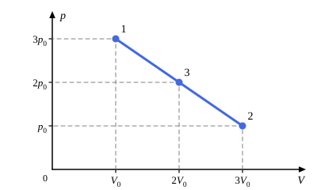

Идеальный газ постоянной массы переводят из состояния 1 в состояние 2 так, что на графике в координатах $p,$ $V$ процесс изображается отрезком прямой (см. рисунок). Состояние 3 лежит на этом отрезке.

Во сколько раз температура газа в состоянии 3 больше, чем в состоянии 1? Ответ округлите до сотых.

## Решение

Масса газа постоянна, поэтому ${\dfrac{pV}{T} = \text{const},}$ температура пропорциональна ${pV.}$ По графику:

$$
\begin{aligned}
p_1 V_1 &= 3p_0 \cdot V_0 = 3p_0V_0, \\
p_3 V_3 &= 2p_0 \cdot 2V_0 = 4p_0V_0.
\end{aligned}
$$

$$
\frac{T_3}{T_1} = \frac{4p_0V_0}{3p_0V_0} = \frac{4}{3} \approx 1{,}33.
$$

Ответ: $1{,}33$.
