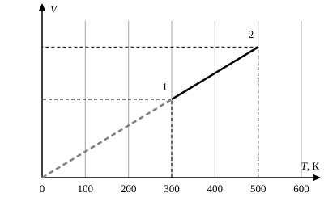

Два моля идеального газа переводят из состояния 1 в состояние 2. На рисунке показан график зависимости объёма газа от его абсолютной температуры; продолжение графика проходит через начало координат.

Определите работу, совершённую газом. Универсальная газовая постоянная ${R = 8{,}31\ \text{Дж/(моль} \cdot \text{К)}.}$ Ответ дайте в килоджоулях, округлив до десятых.

## Решение

Объём пропорционален абсолютной температуре — процесс изобарный. Тогда ${pV = \nu RT}$ даёт ${p\Delta V = \nu R \Delta T}$:

$$
\begin{aligned}
A &= p\Delta V = \nu R (T_2 - T_1) = 2 \cdot 8{,}31 \cdot 200\ \text{Дж} \\
&= 3324\ \text{Дж} \approx 3{,}3\ \text{кДж}.
\end{aligned}
$$

Ответ: $3{,}3\ \text{кДж}$.
