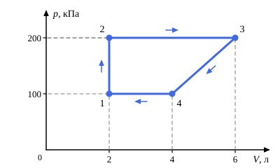

Идеальный газ совершает циклический процесс 1–2–3–4–1, график которого показан на рисунке. За один цикл газ получает от нагревателя ${2{,}5\ \text{кДж}}$ теплоты.

Определите КПД цикла. Ответ дайте в процентах.

## Решение

Работа газа за цикл — площадь трапеции 1–2–3–4. Её основания — отрезки 2–3 длиной ${4\ \text{л}}$ и 4–1 длиной ${2\ \text{л},}$ высота ${100\ \text{кПа}:}$

$$
\begin{aligned}
A &= \frac{4 + 2}{2}\ \text{л} \cdot 100\ \text{кПа} \\
&= 3 \cdot 10^{-3}\ \text{м}^3 \cdot 10^5\ \text{Па} = 300\ \text{Дж}.
\end{aligned}
$$

$$
\eta = \frac{A}{Q_1} \cdot 100\,\% = \frac{300}{2500} \cdot 100\,\% = 12\,\%.
$$

Ответ: $12\,\%$.
