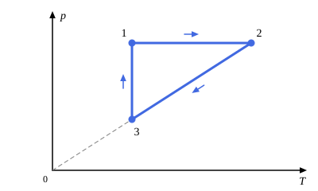

Одноатомный идеальный газ постоянной массы совершает циклический процесс 1 → 2 → 3 → 1, график которого в координатах «давление $p$ — абсолютная температура $T$» показан на рисунке. Продолжение отрезка 2–3 проходит через начало координат.

Из приведённого ниже списка выберите все верные утверждения.

1. В процессе 1 → 2 газ совершает положительную работу.
2. В процессе 2 → 3 работа газа равна нулю.
3. В процессе 3 → 1 внутренняя энергия газа увеличивается.
4. В процессе 3 → 1 газ получает теплоту.
5. Модули изменения внутренней энергии газа в процессах 1 → 2 и 2 → 3 одинаковы.

## Решение

1 → 2: давление постоянно, температура растёт — изобарное нагревание, объём растёт. 2 → 3: точки лежат на прямой ${p \propto T}$ — изохора. 3 → 1: температура постоянна, давление растёт — изотермическое сжатие.

1 — верно: объём растёт, ${A_{12} > 0.}$

2 — верно: объём не меняется, ${A_{23} = 0.}$

3 — неверно: температура постоянна, ${\Delta U_{31} = 0.}$

4 — неверно: ${\Delta U_{31} = 0,}$ газ сжимается, ${A_{31} < 0,}$ поэтому ${Q_{31} = A_{31} < 0}$ — газ отдаёт теплоту.

5 — верно: ${T_3 = T_1,}$ поэтому в процессе 1 → 2 температура растёт от $T_1$ до $T_2,$ а в 2 → 3 падает от $T_2$ до $T_1$ — изменения внутренней энергии равны по модулю.

Ответ: 125.
