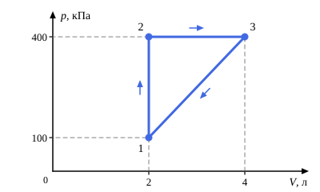

Одноатомный идеальный газ постоянной массы совершает циклический процесс 1 → 2 → 3 → 1, график которого показан на рисунке.

Из приведённого ниже списка выберите все верные утверждения.

1. Работа газа за цикл равна ${300\ \text{Дж}.}$
2. В процессе 1 → 2 газ получает теплоту.
3. Абсолютная температура газа в состоянии 3 в $4$ раза больше, чем в состоянии 1.
4. В процессе 3 → 1 газ совершает положительную работу.
5. В процессе 2 → 3 газ получает количество теплоты ${2\ \text{кДж}.}$

## Решение

1 — верно: работа равна площади треугольника,

$$
\begin{aligned}
A &= \frac{1}{2} \cdot 2\ \text{л} \cdot 300\ \text{кПа} \\
&= \frac{1}{2} \cdot 2 \cdot 10^{-3}\ \text{м}^3 \cdot 3 \cdot 10^5\ \text{Па} = 300\ \text{Дж}.
\end{aligned}
$$

2 — верно: объём постоянен (${A = 0}$), давление и температура растут, ${Q = \Delta U > 0.}$

3 — неверно: ${\dfrac{T_3}{T_1} = \dfrac{p_3V_3}{p_1V_1} = \dfrac{400 \cdot 4}{100 \cdot 2} = 8.}$

4 — неверно: объём уменьшается, работа газа отрицательна.

5 — верно: процесс изобарный,

$$
\begin{aligned}
Q_{23} &= \frac{5}{2}p\Delta V = 2{,}5 \cdot 4 \cdot 10^5\ \text{Па} \cdot 2 \cdot 10^{-3}\ \text{м}^3 \\
&= 2000\ \text{Дж}.
\end{aligned}
$$

Ответ: 125.
