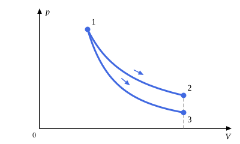

Идеальный газ постоянной массы из состояния 1 расширяется до одного и того же объёма двумя способами: в одном опыте изотермически (переходит в состояние 2), в другом — адиабатно (переходит в состояние 3). Графики процессов показаны на рисунке.

Из приведённого ниже списка выберите все верные утверждения.

1. В процессе 1 → 2 газ отдаёт теплоту.
2. Процесс 1 → 3 — адиабатный.
3. Температура газа в состоянии 3 больше, чем в состоянии 2.
4. Работа газа в процессе 1 → 2 больше, чем в процессе 1 → 3.
5. В процессе 1 → 3 внутренняя энергия газа увеличивается.

## Решение

При адиабатном расширении ${Q = 0,}$ ${\Delta U = -A < 0}$ — температура падает. В изотермическом процессе ${T_2 = T_1.}$ При одинаковом объёме давление ${p = \dfrac{\nu RT}{V}}$ меньше там, где меньше температура, — в конце адиабаты.

1 — неверно: ${\Delta U_{12} = 0,}$ ${Q_{12} = A_{12} > 0}$ — газ получает теплоту.

2 — верно: нижняя кривая заканчивается при меньшем давлении, значит, при меньшей температуре — это адиабата.

3 — неверно: ${T_3 < T_1 = T_2.}$

4 — верно: изотерма лежит выше адиабаты, площадь под ней больше.

5 — неверно: ${\Delta U_{13} = -A_{13} < 0.}$

Ответ: 24.
