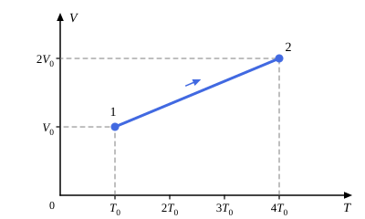

Идеальный газ постоянной массы переводят из состояния 1 в состояние 2. На рисунке показан график зависимости объёма $V$ газа от его абсолютной температуры $T.$

Из приведённого ниже списка выберите все верные утверждения.

1. Давление газа в процессе 1 → 2 увеличилось.
2. Газ совершил положительную работу.
3. Внутренняя энергия газа уменьшилась.
4. Газ отдал теплоту.
5. Процесс 1 → 2 — изобарный.

## Решение

1 — верно: ${\dfrac{p_2}{p_1} = \dfrac{T_2}{T_1} \cdot \dfrac{V_1}{V_2} = 4 \cdot \dfrac{1}{2} = 2.}$

2 — верно: объём растёт, работа газа положительна.

3 — неверно: температура выросла — внутренняя энергия идеального газа увеличилась.

4 — неверно: ${\Delta U > 0}$ и ${A > 0,}$ поэтому ${Q = \Delta U + A > 0}$ — газ получил теплоту.

5 — неверно: давление выросло в $2$ раза; изобара на графике $V(T)$ — прямая, проходящая через начало координат, а эта — нет.

Ответ: 12.
