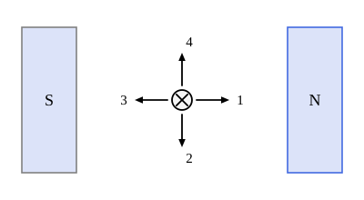

Прямой проводник с током расположен между полюсами магнита перпендикулярно плоскости рисунка, ток идёт от нас. Какой стрелкой — 1, 2, 3 или 4 — направлена сила Ампера, действующая на проводник? В ответ запиши номер стрелки.

## Решение

Линии поля идут от северного полюса к южному — здесь справа налево. Левую руку ставим так, чтобы линии входили в ладонь (ладонь смотрит вправо, навстречу полю), четыре пальца — по току, от нас. Отогнутый большой палец показывает вверх.

Ответ: $4$.
