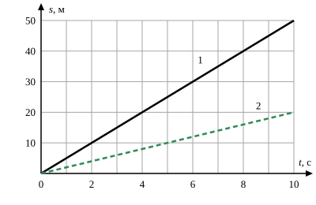

На рисунке — графики зависимости пути от времени для двух велосипедистов, которые стартовали одновременно и едут равномерно. На сколько метров больше первый проедет за $8\ \text{с}$, чем второй?

## Решение

Скорости по графикам: $v_1 = \dfrac{50}{10} = 5\ \text{м/с}$, $v_2 = \dfrac{20}{10} = 2\ \text{м/с}$.

За $8\ \text{с}$: $s_1 = 5 \cdot 8 = 40\ \text{м}$, $s_2 = 2 \cdot 8 = 16\ \text{м}$.

Разница: $40 - 16 = 24\ \text{м}$.

Ответ: $24\ \text{м}$.
