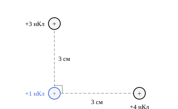

В вершине прямого угла находится точечный заряд $+1\ \text{нКл}$. На сторонах угла на расстоянии $3\ \text{см}$ от вершины закреплены заряды $+3\ \text{нКл}$ и $+4\ \text{нКл}$ (см. рисунок). С какой силой оба заряда вместе действуют на заряд в вершине? ${k = 9 \cdot 10^9\ \text{Н} \cdot \text{м}^2/\text{Кл}^2}$. Ответ дай в микроньютонах.

## Решение

Силы от каждого заряда:

$$
F_1 = 9 \cdot 10^9 \cdot \frac{10^{-9} \cdot 3 \cdot 10^{-9}}{0{,}03^2} = 3 \cdot 10^{-5}\ \text{Н} = 30\ \text{мкН},
$$

$$
F_2 = 9 \cdot 10^9 \cdot \frac{10^{-9} \cdot 4 \cdot 10^{-9}}{0{,}03^2} = 4 \cdot 10^{-5}\ \text{Н} = 40\ \text{мкН}.
$$

Обе силы отталкивающие и направлены вдоль сторон прямого угла — они перпендикулярны. Складываем по теореме Пифагора:

$$
F = \sqrt{30^2 + 40^2} = 50\ \text{мкН}.
$$

Ответ: $50\ \text{мкН}$.
